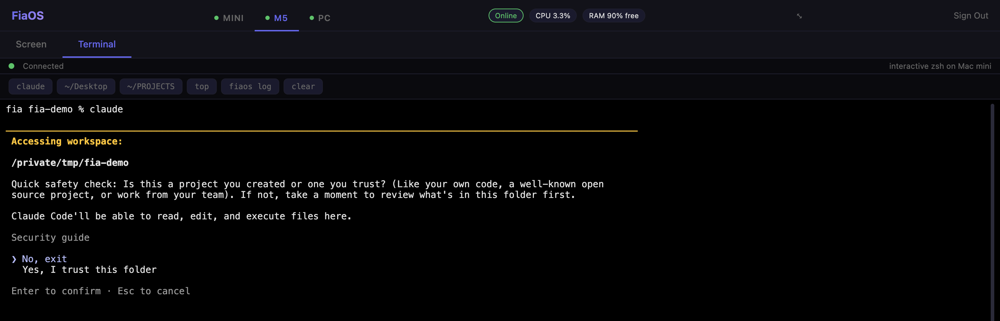
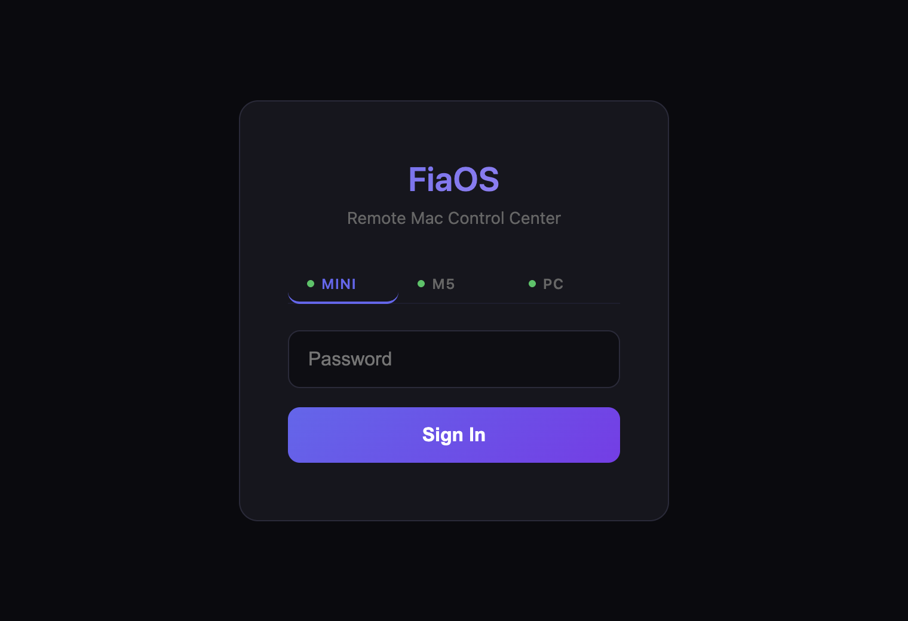
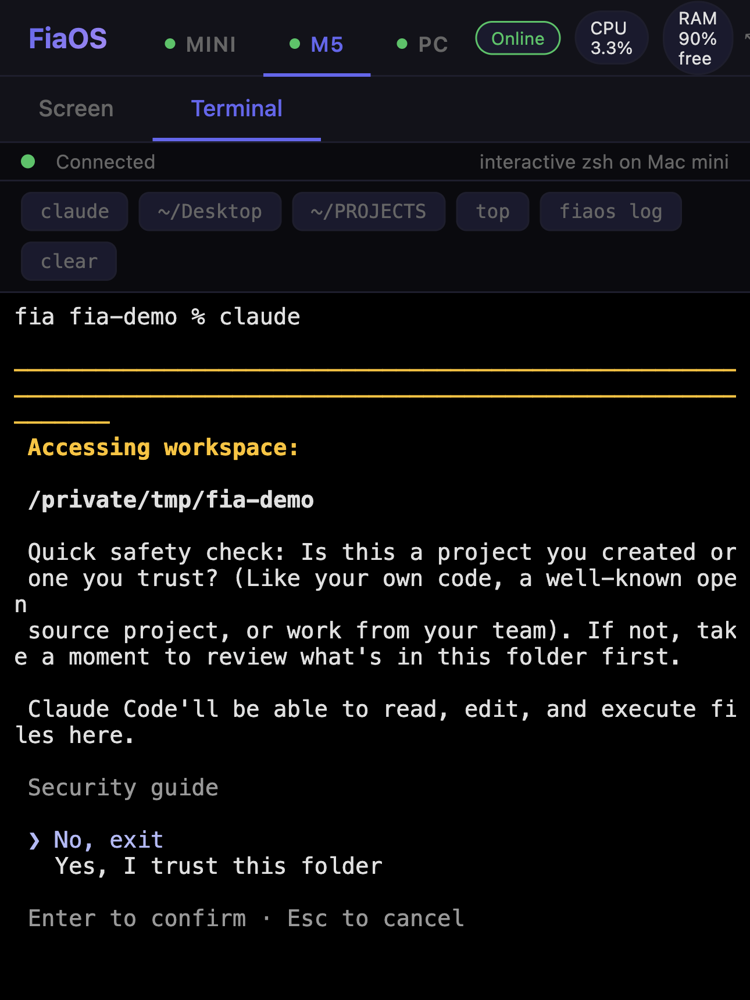

# FiaOS

FiaOS is a small Python web server you run on each of your computers. Open its page in any browser, log in once, and you get that machine's live screen and a real terminal. It runs on Apple Silicon Macs and on Windows 10/11, and several machines can sit behind one URL with one login.

There is no client to install and no cloud service in the path. You host it yourself.

## What you get

**Screen.** A live view of the desktop, streamed as 128 px JPEG tiles. Only tiles that changed are sent, so a still desktop costs almost nothing. Click, drag, scroll and type on it and the events go to the real machine.

**Terminal.** A real PTY. On macOS it is `zsh -l -i` behind `pty.openpty()`; on Windows it is PowerShell inside a ConPTY via `pywinpty`. Anything that needs a TTY works: `claude`, `vim`, `top`, `htop`, `python -i`. The browser side is [xterm.js](https://xtermjs.org/).

**Machines.** Tabs across the top (the shipped UI labels them Mini, M5 and PC). Picking one sets a `fia_target` cookie, and either nginx or the Windows server's built-in proxy sends you to that machine. Session tokens are signed with the shared password, so the login carries over.

## Who it is for

- People running **Claude Code** (or any terminal tool) on a Mac or PC who want to drive it from a phone or another computer.
- Headless homelab setups: Mac minis or PCs with no monitor attached.
- Mixed Mac and Windows setups that want one page and one password for both.
- Anyone who wants to replace an SSH client plus a VNC viewer with a single web page they host themselves.

It is not a general multi-user remote access product. There is one shared password per fleet, and anyone who has it has the same power as an SSH login. See [Configuration > Security notes](configuration.md#security-notes).

## On a phone

The screen view handles touch: one finger drags, two fingers scroll, a long press right-clicks (from `static/index.html`). When the page is opened from a non-LAN address, the browser asks for a smaller, lower-quality stream to save bandwidth.

## Tested

The repo ships its own tests, described in [`tests/README.md`](https://github.com/nicedreamzapp/FiaOS/blob/main/tests/README.md):

- `tests/test_auth.py` runs auth and session checks against the real `server.py` with a throwaway password and temp state files. The test README and the main README both say 62 checks. A run while building these docs (Linux, Python 3.13, aiohttp 3.10) printed `RESULT: 62 passed, 0 failed`.
- `tests/test_infra.sh` breaks a live deployment on purpose (freezes the server, kills the tunnel, plants a zombie listener on the VPS) and measures recovery. It needs a real deployment to run.

## Next steps

- [Install](install.md) on macOS or Windows
- [Quickstart](quickstart.md): from clone to a working terminal in the browser
- [How it works](how-it-works.md): the screen pipeline, the PTY, signed sessions, multi-machine routing
- Source on GitHub: [nicedreamzapp/FiaOS](https://github.com/nicedreamzapp/FiaOS)

FiaOS is built on other people's work, including xterm.js, aiohttp, psutil, pywinpty and PyObjC. Its natural-language helper calls the Anthropic [Claude Code](https://claude.com/claude-code) CLI. See [Credits](credits.md).
